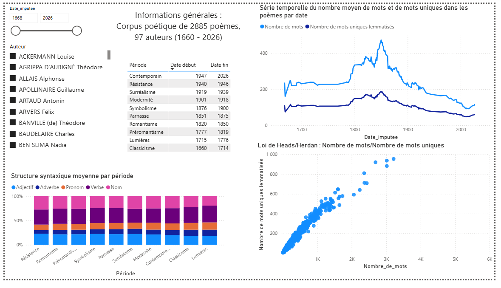
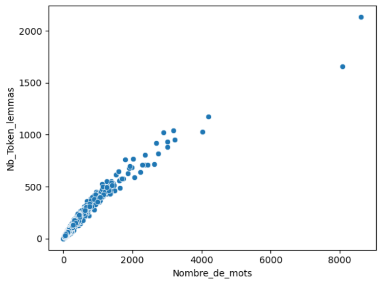

# Poetica

# Analyse d'un corpus de poèmes français

Python · Web scraping · NLP · Power BI · Formation

Collecte par scraping de près de 3 200 poèmes français, traitement automatique du texte (lemmatisation, analyse syntaxique) et dashboard interactif pour explorer l'évolution de la langue poétique de 1660 à nos jours.

## Contexte

Ce projet a été réalisé dans le cadre de ma formation de Data Analyst chez OpenClassrooms, en projet libre. J'ai choisi la poésie comme prétexte pour explorer les données textuelles : un domaine où la donnée n'existe pas « toute prête » et doit être construite de bout en bout.

Question de départ : peut-on mesurer, avec des indicateurs simples, la diversité lexicale et les habitudes syntaxiques des poètes, par auteur et par période littéraire ?

## Démarche

1. **Collecte (Python, Selenium)**
   - Scraping du site Poetica.fr en trois niveaux : liste des 118 auteurs, liste des poèmes de chaque auteur, puis page de chaque poème
   - Extraction de l'auteur, du titre, du texte, de la date, de la référence, de l'URL et du nombre de mots
   - Résultat : un fichier JSON de **3 180 poèmes**

2. **Reconstitution de la chronologie**
   - **1 632 poèmes sur 3 180 (51 %) n'ont pas de date**
   - 16 auteurs sur 118 n'ont aucune date et sont exclus, 86 en ont de façon partielle
   - Pour les auteurs partiellement datés, imputation des dates manquantes par tirage aléatoire dans une estimation de densité (KDE) construite à partir des dates connues de l'auteur
   - Regroupement en 10 périodes littéraires, du Classicisme au Contemporain

3. **Traitement du texte (NLP)**
   - Lemmatisation (« vivons » → « vivre »)
   - Liste de mots vides personnalisée (déterminants, prépositions, conjonctions) plutôt que celle de spaCy, jugée inadaptée à la poésie
   - Calcul du nombre de mots et du nombre de lemmes uniques par poème

4. **Extraction syntaxique**
   - Étiquetage grammatical de chaque poème et calcul de la part de noms, verbes, adjectifs, adverbes et pronoms

5. **Dashboard (Power BI)**
   - 3 pages : vue générale, analyse par période, analyse par auteur
   - Corpus final de **2 885 poèmes** et **97 auteurs**

## Résultats

- Un corpus qui couvre trois siècles, mais très déséquilibré : **966 poèmes contemporains** (un tiers du corpus) et 628 du Parnasse, contre 7 pour les Lumières ou la Résistance
- Le ratio lemmes / mots (indice de diversité lexicale) passe d'environ **0,40 au Romantisme à 0,49 pour la période contemporaine**
- Cette évolution est aussi une affaire de longueur : le poème moyen passe de plus de 430 mots au Romantisme à environ 116 mots aujourd'hui. Le nombre de mots uniques croît moins vite que la longueur du texte, comme le prévoit la loi de Heaps (ou de Herdan), ce que mes mesures vérifient.
- La structure grammaticale moyenne permet de comparer chaque période et chaque auteur, et de repérer les poètes dont le style s'écarte de la moyenne de leur époque

## Aller plus loin : analyses complémentaires

Le scraping, la reconstitution d'un jeu de données exploitable et les indicateurs sont le cœur du projet. J'ai aussi :

- **Imputé statistiquement les dates manquantes** (KDE par auteur) plutôt que d'écarter la moitié du corpus
- **Mis en évidence la loi de Heaps/Herdan** pour interpréter correctement mes indicateurs, en voyant que les mesures simples de diversité dépendent de la taille des textes
- **Défini deux indicateurs sur mesure**, en DAX : l'indice de diversité lexicale (lemmes / mots) et un score d'**originalité syntaxique**, qui mesure l'écart d'un auteur, d'une période ou d'un poème par rapport à la structure grammaticale moyenne
- **Construit une liste de mots vides sur mesure**, adaptée à la langue poétique

## Réalisations

**Mesures DAX : diversité lexicale et originalité syntaxique**

```
Indice_de_diversité_lexicale_auteur_ =
CALCULATE(
    SUM('df final'[Nb_Token_lemmas]) / SUM('df final'[Nombre_de_mots]),
    ALLEXCEPT('df final', 'df final'[Auteur])
)

Originalité_syntaxique_meme_auteur_ =
ABS(CALCULATE(AVERAGE('df pos final'[ADJ_ratio]),
              ALLEXCEPT('df final', 'df final'[Auteur]))
    - MAX('df pos final'[ADJ_ratio]))
+ ABS( ... ADV_ratio ... )
+ ABS( ... NOUN_ratio ... )
+ ABS( ... PRON_ratio ... )
+ ABS( ... VERB_ratio ... )
```


*Dashboard : vue générale*


*Nombre de mots uniques en fonction du nombre de mots (loi de Heaps/Herdan)*

## Limites et perspectives

- Les dates de la moitié des poèmes sont simulées : l'analyse est fiable en tendance par période, pas poème par poème
- Certaines périodes ne reposent que sur un seul auteur
- Remplacer le ratio lemmes / mots par un indice moins sensible à la longueur des textes (MATTR, indice de Guiraud)
- Enrichir le corpus avec d'autres sources et analyser les thèmes (topic modeling)

## Stack

`Python` · `Selenium` · `pandas` · `spaCy` · `seaborn` · `Power BI` · `DAX` · `Power Query`

[Voir le projet complet sur GitHub →]()
[Retour à la liste de projets →]()
